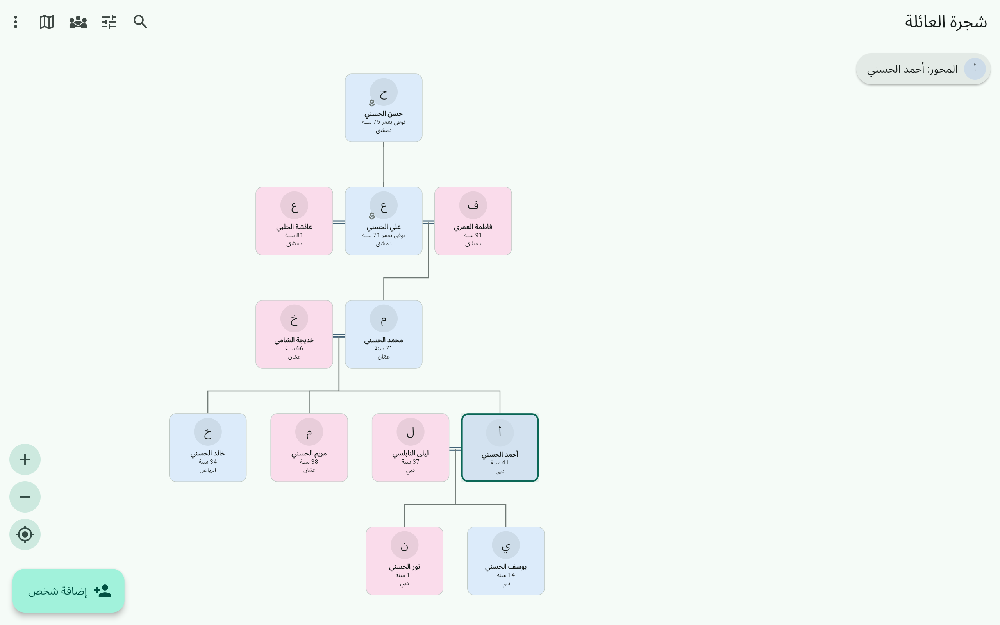
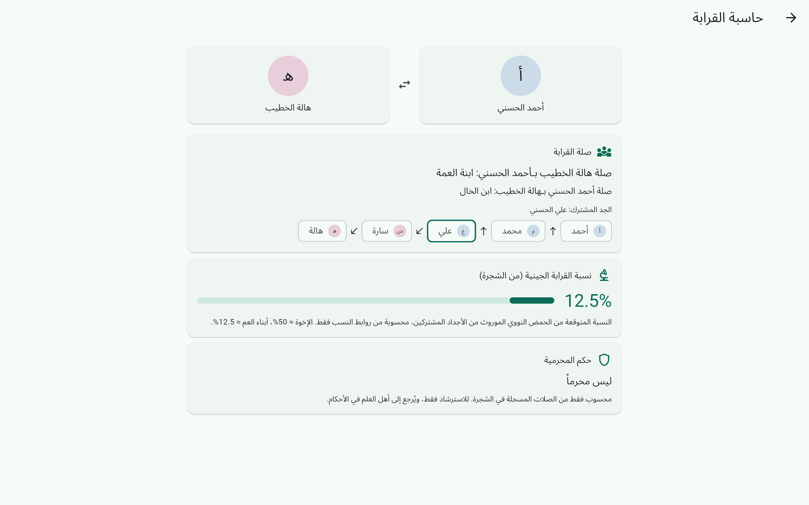
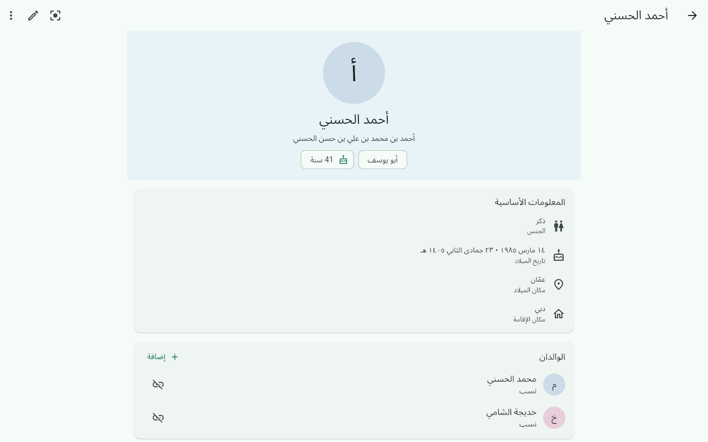

# شجرة العائلة · Family Tree

تطبيق Flutter لشجرة العائلة يعمل على **Android وiOS والويب وWindows وmacOS وLinux** بشيفرة واحدة، ويدعم **العربية والإنجليزية** مع إمكانية إضافة لغات أخرى.

A cross-platform Flutter family-tree app (Android, iOS, Web, Windows, macOS, Linux) in Arabic and English, with optional Supabase cloud sync.

---

## الميزات

| الميزة | التفاصيل |
|---|---|
| بيانات الأشخاص | الاسم واسم العائلة والكنية واللقب والقبيلة والجنس، وتاريخ ومكان الميلاد، والوفاة، والصورة، والملاحظات |
| القرابة | الوالدان (نسب / كفالة وتبنٍّ / **رضاعة**)، وزواج متعدد مع الطلاق والترمّل، والإخوة الأشقاء ولأب ولأم |
| أماكن الإقامة | أماكن متعددة لكل شخص مع تاريخ البداية والنهاية والموقع على الخريطة (بحث أو نقر) |
| رسم الشجرة | شجرة تفاعلية (سحب وتكبير) **محورها أي شخص تختاره**: الأجداد في الأعلى والأحفاد في الأسفل والإخوة والأزواج في نفس الصف، وتُعرض من اليمين لليسار في العربية |
| الملخص في البطاقة | تختار ما يظهر: الصورة، النسب، العمر، تاريخ الميلاد أو الوفاة، مكان الميلاد، الإقامة الحالية، القبيلة، الكنية. ويمكن ضبط عدد الأجيال وإظهار الإخوة والأعمام والأزواج |
| صفحة التفاصيل | المعلومات، وصلة الشخص بمحور الشجرة، والوالدان والأزواج والأبناء والإخوة (مع الإضافة والربط وفك الربط)، وأماكن الإقامة، و**خط زمني** لأحداث الحياة |
| النسب | "أحمد بن محمد بن علي الحسني"، مع إمكانية نسخه |
| التقويم | ميلادي أو هجري أو كلاهما |
| **حاسبة القرابة** | اسم الصلة بالعربية (عم، خال، ابن العمة…) وبالإنجليزية (first cousin once removed…)، ومسار القرابة عبر الجد المشترك |
| **نسبة القرابة الجينية** | معامل القرابة (Wright) محسوباً من الشجرة: الأخ 50%، ابن العم 12.5%… |
| **حاسبة المحارم** | بالنسب والرضاعة والمصاهرة، مع شرط الدخول حين يلزم، وتنبيه بأنها للاسترشاد |
| **تشابه الملامح** | ترتيب أفراد العائلة حسب الشبه بالوجه، عبر خدمة سحابية آمنة وبموافقة صريحة لكل شخص |
| خريطة العائلة | كل أماكن الإقامة على خريطة OpenStreetMap، ومسار تنقّل الشخص |
| GEDCOM | استيراد وتصدير بالمعيار العالمي (مع الدمج أو الاستبدال) |
| تصدير | الشجرة كصورة PNG أو PDF للطباعة |
| الحساب والحفظ أونلاين | تسجيل بالبريد أو Google، وحفظ في Supabase مع صلاحيات مالك/محرر/مشاهد، ورفع الشجرة المحلية عند أول تسجيل |
| دون اتصال | بدون تسجيل دخول تُحفظ الشجرة على الجهاز |

## التشغيل

```bash
cd family_tree_app
flutter pub get
flutter run -d chrome          # الويب
flutter run -d windows         # أو macos / linux / android / ios
flutter test                   # الاختبارات
```

يعمل التطبيق مباشرة **بالحفظ المحلي**. لتفعيل تسجيل الدخول والحفظ السحابي ومقارنة الوجوه:

```bash
flutter run --dart-define=SUPABASE_URL=https://<project>.supabase.co \
            --dart-define=SUPABASE_ANON_KEY=<publishable-key>
```

## إعداد Supabase

1. أنشئ مشروعاً على [supabase.com](https://supabase.com).
2. نفّذ `supabase/migrations/0001_init.sql` (من SQL Editor أو `supabase db push`). ينشئ الجداول وسياسات RLS وحاوية الصور الخاصة `photos`.
3. **Authentication → Providers**: فعّل Email و(اختيارياً) Google. أضف عنوان التطبيق إلى Redirect URLs (للويب: عنوان الموقع؛ للجوال: deep link مثل `com.familytree.family_tree://login-callback`).
4. **مقارنة الوجوه** (اختياري):
   ```bash
   supabase secrets set AWS_REGION=eu-central-1 AWS_ACCESS_KEY_ID=... AWS_SECRET_ACCESS_KEY=...
   supabase functions deploy face-similarity
   ```
   تستخدم الدالة AWS Rekognition، ولا تُخزَّن الصور. يمكن استبدال المزوّد بتعديل `compare()` في `supabase/functions/face-similarity/index.ts`.

> ملاحظة: خدمات مقارنة الوجوه مصممة للتحقق من الهوية، لذا تكون الدرجات بين شخصين مختلفين منخفضة نسبياً حتى بين الأقارب. استخدمها للترتيب النسبي لا كاحتمال.

## إضافة لغة جديدة

1. انسخ `lib/l10n/app_en.arb` إلى `lib/l10n/app_<code>.arb` (مثلاً `app_fr.arb`) وترجم القيم.
2. أضف الاسم الأصلي للغة في `languageNames` في `lib/ui/screens/settings_screen.dart`.
3. (اختياري) أضف أسماء صلات القرابة بتلك اللغة بتنفيذ `RelationshipNamer` في `lib/logic/relationship_names.dart`. بدونها تُستخدم الإنجليزية.

## البنية

```
lib/
  models/models.dart          نموذج البيانات: Person, Union, ParentLink, Residence
  logic/
    tree_layout.dart          خوارزمية رسم الشجرة حول المحور (مع RTL)
    kinship.dart              مسار القرابة، معامل القرابة، المحارم
    relationship_names.dart   تسمية الصلات بالعربية والإنجليزية
    lineage.dart              سلسلة النسب
    gedcom.dart               استيراد/تصدير GEDCOM 5.5.1
    dates.dart                التنسيق الميلادي/الهجري
  data/                       التخزين المحلي، Supabase، عائلة تجريبية
  state/                      الإعدادات، الشجرة، الحساب (Provider)
  services/cloud.dart         إعداد Supabase، الصور، خدمة تشابه الوجوه
  ui/                         الشاشات والمكوّنات
supabase/                     المخطط وسياسات الأمان ودالة مقارنة الوجوه
test/                         اختبارات المنطق والواجهة
```

## مقترحات للمراحل القادمة

- واجهة **دعوة الأقارب** للتعاون (الجداول والصلاحيات جاهزة في قاعدة البيانات).
- **خصوصية الأحياء**: إخفاء تواريخ وصور الأحياء عن المشاهدين.
- مزامنة **دون اتصال** مع حل التعارضات (حالياً: إما محلي أو سحابي).
- **تذكير بالمناسبات** (أعياد الميلاد، ذكرى الزواج) بالإشعارات.
- **كشف الأشخاص المكررين** ودمجهم، ومرفقات (وثائق وتسجيلات صوتية).
- إدخال **سنة فقط** أو تاريخ تقريبي للأجداد القدامى.

## لقطات الشاشة

| الشجرة | حاسبة القرابة | التفاصيل |
|---|---|---|
|  |  |  |
